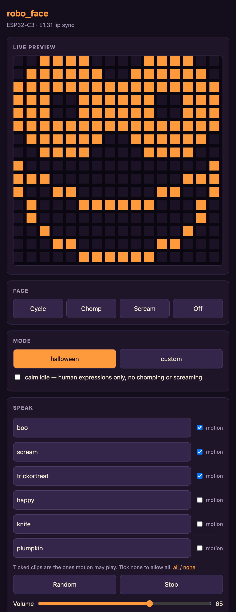
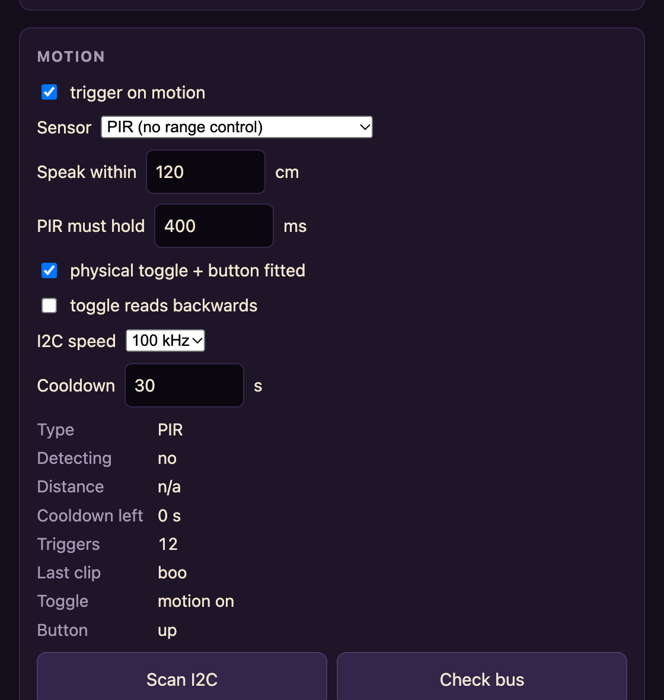
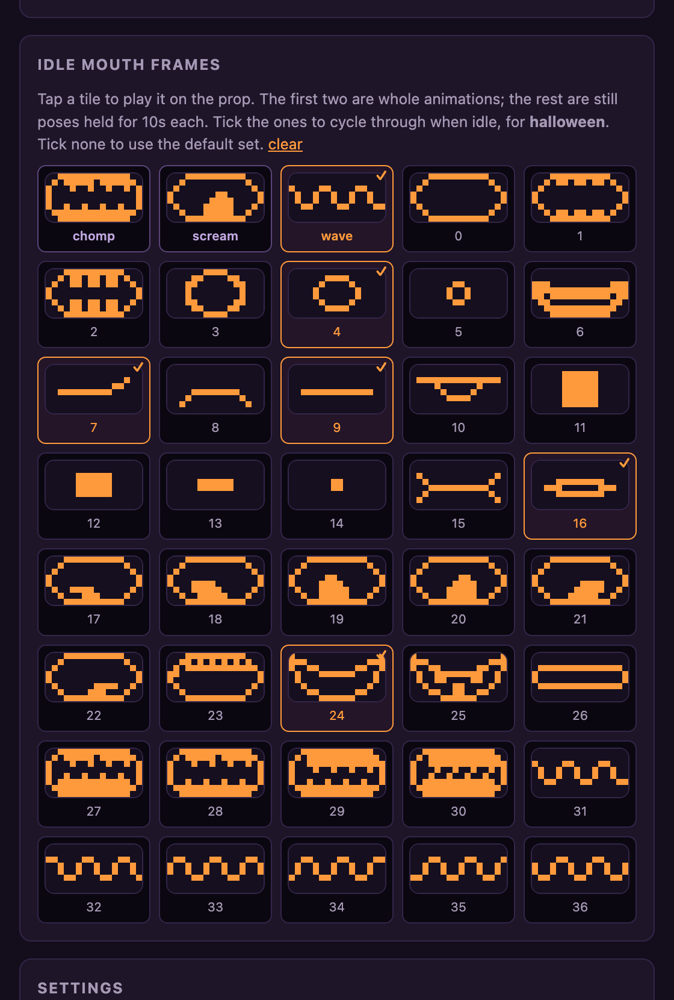
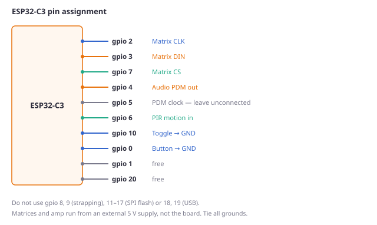
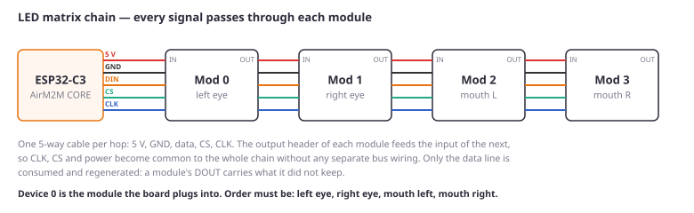
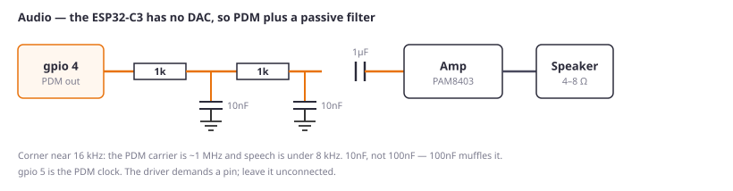

<div align="center">

# robo_face

**An ESP32 robot face that talks.** Animated LED eyes, a mouth that lip-syncs
to speech, and a web UI to drive it all. Runs standalone on a motion sensor,
or takes lip-sync data from an xLights/FPP light show over E1.31.


*Built as a Halloween prop — a carved pumpkin over the matrices.
[Full clip with sound](docs/media/robo-face.mp4).*

</div>

---

## What it does

- **Eyes that look alive.** They drift, blink on their own schedule, twitch
  one eye now and then, and run cross-eyes, spins, a lazy eye and a glow. A
  blink can interrupt whatever is playing mid-step and resume it.
- **A mouth that lip-syncs.** Ten Preston Blair phoneme shapes, driven either
  by a stored clip or live from a show controller.
- **Talks by itself.** A motion sensor or push button fires a clip; the mouth
  syncs to a cue track computed when the clip was built, so playback is exact
  and costs almost nothing at runtime.
- **Plays in a light show.** E1.31/sACN receiver, drop-in compatible with the
  xLights Faces dialog. Takes over the mouth while a sequence runs and goes
  back to idling 2 s after it stops.
- **Configured from a phone.** Mode, clips, volume, brightness, sensor
  tuning, WiFi, E1.31 universe — all from a web page, saved to NVS.
- **No infrastructure needed.** With no network it hosts its own WiFi and
  serves the whole control page there.
- **No DAC required.** Audio leaves as PDM on one pin into a passive filter,
  so a plain analog amp works.

## It looks like this

<table>
<tr>
<td width="50%"></td>
<td width="50%"></td>
</tr>
<tr>
<td colspan="2" align="center"><em>Live panel preview, clip list with per-clip motion
toggles, and the sensor tuning that keeps a PIR from firing at thin air</em></td>
</tr>
</table>

<div align="center">


*Every mouth frame, drawn. The first three tiles are whole animations and
animate in the browser. Tap one to play it on the prop; tick the ones to
cycle through when idle.*
</div>

## Hardware



| | |
|---|---|
| MCU | ESP32-C3 (developed on an AirM2M CORE board) |
| Display | 4 × MAX7219 8×8 matrices — 2 eyes, 2-module mouth |
| Audio | PDM out → RC filter → any analog amp → 4–8 Ω speaker |
| Sensor | PIR on one GPIO. A toggle and push button are optional |
| Power | External 5 V, ≥ 2 A. **Not USB** |

A classic ESP32 (WROOM-32) is also a supported build target.

### Matrix wiring



### Audio



The ESP32-C3 has I2S but no DAC, so it cannot put analog on a pin. It *can*
transmit PDM, so one GPIO plus two RC stages drives an ordinary analog amp —
no DAC board. Full detail, including the 3.3 V-into-5 V question and why
**USB cannot power this**, is in **[docs/HARDWARE.md](docs/HARDWARE.md)**.

## Quick start

```sh
alias pio=~/.platformio/penv/bin/pio

pio run -e c3 -t upload       # firmware
pio run -e c3 -t uploadfs     # audio clips from data/
```

With no network configured it hosts its own: join **`robo_face`** and open
**http://192.168.4.1**. Use the WiFi section there to join your network,
after which it is at **http://robo-face.local**.

Make a clip from text or a recording:

```sh
python3 tools/make_clip.py --say "Nice of you to drop by" --voice Daniel --loud 3 \
    -o data/halloween/hello.pfc
pio run -e c3 -t uploadfs
```

Lip sync is computed **offline** by that script — loudness for how open the
mouth is, spectral centroid to separate rounded from spread vowels, and
zero-crossing rate to catch fricatives. The firmware just replays the cue
list. Driving the mouth from a live audio envelope was tried and rejected: it
produces a nutcracker, not speech.

## Documentation

| | |
|---|---|
| [docs/SETUP.md](docs/SETUP.md) | Toolchain, flashing, WiFi, clips, physical controls, xLights |
| [docs/HARDWARE.md](docs/HARDWARE.md) | BOM, pinout, wiring, power, and the failure modes to recognise |
| [docs/THEORY.md](docs/THEORY.md) | How it works inside: the loop, the eye engine, lip sync, E1.31 |
| [docs/TESTING.md](docs/TESTING.md) | Test procedures in dependency order, plus troubleshooting |
| [docs/TOOLS.md](docs/TOOLS.md) | The host scripts: artwork, clips, scream synthesis, sACN sender |
| [HANDOFF.md](HANDOFF.md) | Design decisions and the traps that cost real debugging time |
| [CLAUDE.md](CLAUDE.md) | Operating notes for an AI agent working on this repo |

## Notes from building it

A few things that cost time and might save you some:

- **Suspect power before firmware.** Three separate faults here were power:
  fanning 5 V from the dev board, corroded dupont pins, and running from USB.
  Each looked like something else — dead panels, drifting brightness, a
  twitchy sensor.
- **A panel going *blank* means power; *garbage* means signal integrity.**
  Below its minimum voltage a MAX7219 resets into shutdown, which is dark.
- **The driver de-duplicates writes**, so if a module browns out and loses
  its registers the display stays wrong forever while the firmware runs
  happily. There is a periodic resync for exactly this.
- **A PIR next to an audio amp will trigger itself.** The sensor is ignored
  while a clip plays and for a few seconds after.

## Licence

MIT — see [LICENSE](LICENSE).
